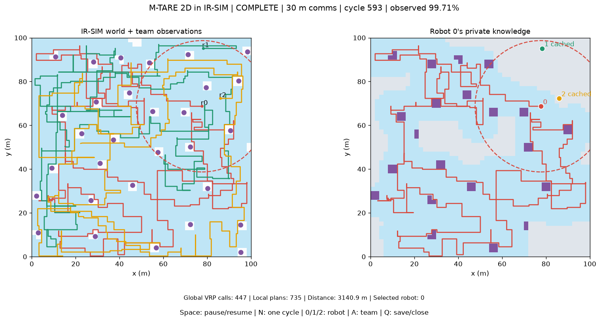

# M-TARE-based 2D exploration baseline

A research adaptation of M-TARE for algorithm-only, multi-robot exploration in
an initially unknown 2D occupancy grid. Global planning allocates and orders
coarse exploration regions using OR-Tools VRP. Local planning selects coverage
viewpoints and orders them with a separate TSP.

This is a Python adaptation with explicit planar choices and exclusions, not
the original ROS M-TARE binaries or a demonstrated full-system reproduction.
The intended research focus is global allocation/routing, communication and
future comparisons with richer belief sharing.



## Install

Tested with Python 3.12 on Linux. Git is needed for the pinned IR-SIM source.
The setup creates a local `.venv`; no activation is required by the launchers.

```bash
git clone <your-private-repository-url> mtare-2d
cd mtare-2d
./setup.sh recording
```

`recording` installs the planner, IR-SIM and Rerun. For smaller installations,
use `./setup.sh core` for the original Matplotlib viewer, or `./setup.sh irsim`
without Rerun. Linux live Matplotlib windows require Python's Tk support.
Exact dependencies and upstream revisions are pinned in the lock files.

## Run

Original live viewer, with three robots and 30 m communication:

```bash
./run.sh --robots 3 --range 30 --solver-ms 80 --paused
```

IR-SIM live viewer:

```bash
./run_irsim.sh --robots 3 --range 30 --solver-ms 80 --paused
```

Space starts/pauses; N advances one cycle; 0/1/2 switch private maps and the
communication circle; A shows team observations; Q saves and closes.
Use `--range full` for unrestricted communication.

Record headlessly, then open Rerun automatically:

```bash
./run_irsim.sh --robots 3 --range 30 --solver-ms 80 --headless --rerun
```

Rerun saves the initial state and every logical cycle, with visual frames,
private maps, routes, communication ranges, coverage and planner status. Use
the `cycle` timeline to inspect playback. Individual movement substeps are not
separate recorded frames. Reopen the latest recording using:

```bash
./view_rerun.sh
```

Without `--rerun`, recording is off. Append `--no-open` for unattended runs.
For original-viewer headless runs use `./run.sh --headless --no-frames --no-open`.
Original results are under `runs/`; IR-SIM results are under `ir_sim/runs/`.
`./view_results.sh` and `./view_irsim.sh` reopen each backend's saved result.

## What is retained and what is adapted

- Global region VRP, proposal adaptation/selection and local coverage/TSP follow
  retained M-TARE procedures over explicit 2D geometry.
- Occupancy is private. Robots exchange coarse region status, roadmap links,
  cached poses and proposed team routes within the configured communication range.
- Coverage uses planar free-area samples and separate frontier samples, not
  original 3D surface-point observations. Sample thresholds are adapted.
- Motion follows known-free, axis-adjacent paths on a dense viewpoint lattice,
  with restored lookahead/direction and local priority handling.
- IR-SIM uses external-state mode: the existing simulation supplies motion and
  observations. IR-SIM internal dynamics, LiDAR and navigation controllers do
  not drive the planner.
- ROS, SLAM, physical sensing/control, pursuit, rendezvous, convoy and return
  home are excluded. The EM repository supplies environment-generation context;
  its EM planning objective and estimation methodology are excluded.
- Region-report conflict repair, peer-completed coverage suppression and idle
  finalization are documented adaptation extensions.

## Completion and known limitations

The default observer stops on a fresh planning round after cycle 300 when
team observation is at least **91%**, every own VRP route is empty, and all
local coverage/viewpoint/navigation work is complete. Reaching 91% alone does
not stop exploration. `--completion-min-coverage` changes this fraction.
The default maximum of 1,200 cycles is an incomplete cutoff.

The 91% floor is our experiment rule, not an original M-TARE threshold. It
uses the evaluator's truth-reachable denominator only to stop the simulation;
this knowledge is not supplied to robot planning. It can stop an idle team
whose private global lists still allocate residual work to teammates. Record
that outcome separately from exhaustion of all eligible global regions.

Independent private team solutions can disagree on ownership, and robots can
revisit team-observed areas while gaining private knowledge. Original-style
decentralized behavior versus adaptation errors still needs focused global
planner fidelity auditing. Passing consistency tests is not equivalence proof.

## Tests and audits

```bash
./test.sh           # planner suite; optional original-source tests may skip
./test.sh --all     # also IR-SIM and Rerun integration tests
.venv/bin/python verify_run.py <complete-run-directory>
```

Optional compiled reference tests require g++, the original M-TARE checkout,
and `MTARE_ORIGINAL_ROOT` pointing to its root. With that reference present,
the packaged suites contain 127 planner tests plus 3 bridge/recording tests.
See [validation notes](docs/VALIDATION.md) for the tests actually run for this
repository package.

## Reading the code

- [System overview](docs/SYSTEM_OVERVIEW.md): planning, communication and data flow.
- [Context for ChatGPT/reviewers](docs/CHATGPT_CONTEXT.md): project scope and file map.
- [Comparison guidance](docs/COMPARISON.md): appropriate baselines and metrics.
- [Publishing privately](PUBLISHING.md): GitHub login and upload commands.
- [Attribution and license provenance](THIRD_PARTY_NOTICES.md).
- `docs/history/`: earlier design notes and results; some describe superseded
  behavior. Current source and this README define this snapshot.

The small [example result](examples/range30/README.md) is for inspection, not
a statistical benchmark. Large runs, recordings, environments and upstream
checkouts are excluded from Git.
